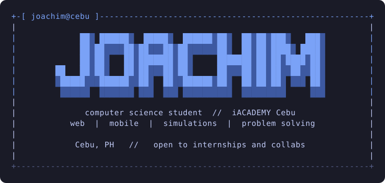
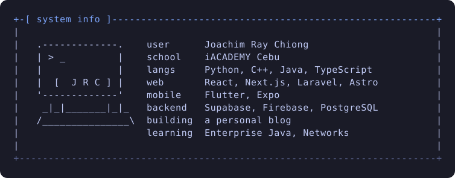
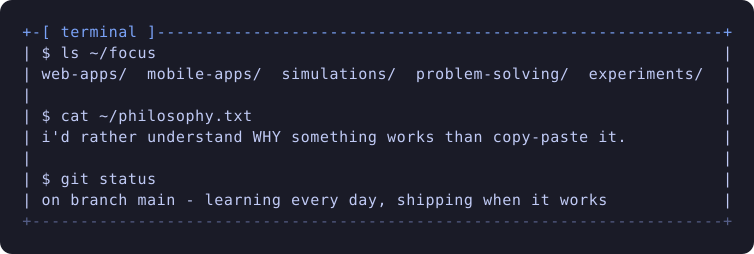
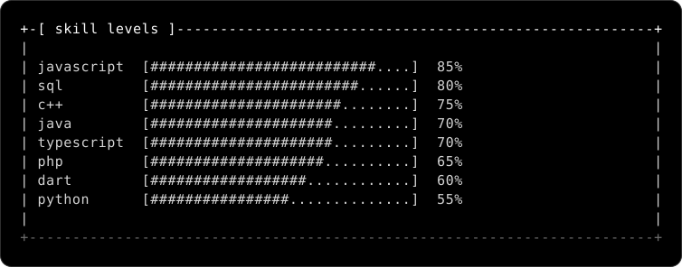
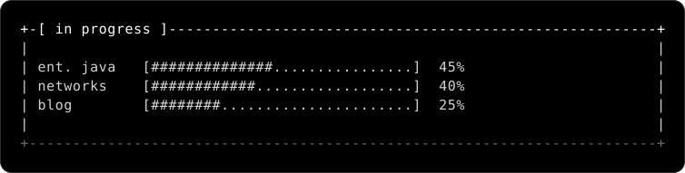
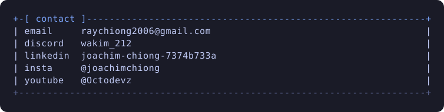
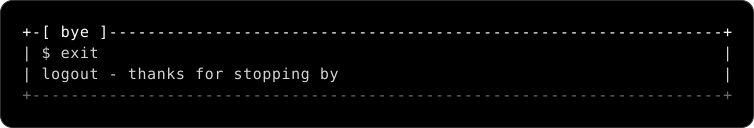

  

  

  

  

  

  

  

  

  
  

  

  

  

  <a href="mailto:raychiong2006@gmail.com">[ email ]</a>
  <a href="https://www.linkedin.com/in/joachim-chiong-7374b733a">[ linkedin ]</a>
  <a href="https://discord.com/users/wakim_212">[ discord ]</a>
  <a href="https://www.instagram.com/joachimchiong/">[ instagram ]</a>
  <a href="https://www.youtube.com/@Octodevz">[ youtube ]</a>

  

  

